# Hybrid Anomaly Detection for IoT Smart Dormitory: Experiment Report

## MEWMA + BiLSTM-AE with Dynamic Weighted Fusion

---

## 1. Dataset overview

The dataset comes from a real-world IoT smart dormitory platform (source confidential, NDA-protected) covering 7 node categories across environmental, safety, energy, water, access, facility, and video analytics subsystems.

| Property | Value |
|---|---|
| Rows | 11,616 |
| Columns | 77 |
| Time range | 1 Nov 2025 – 30 Jun 2026 |
| Interval | 30 minutes |
| Missing values | 0 |
| Duplicates | 0 |
| Node categories | 7 (HVAC, fire safety, energy, water, access, facility, CCTV) |

No expert-annotated ground truth exists. The column `is_anomaly_proxy` is a system-generated label derived from `command_log_level` (1 when any node reports WARNING or CRITICAL). This proxy label is used for evaluation only — models are trained without it.

---

## 2. Exploratory data analysis

### 2.1 Feature distributions

31 continuous features were analyzed. All values fell within physically plausible domain ranges (indoor temperature 23–31.5°C, voltage 213–229V, grid frequency 49.86–50.14 Hz, etc.). Several features showed bimodal distributions driven by diurnal cycles (lux, building occupancy, facility power), while safety-related features (gas_raw, smoke, flame) were near-zero dominated with extreme tails during anomaly events.

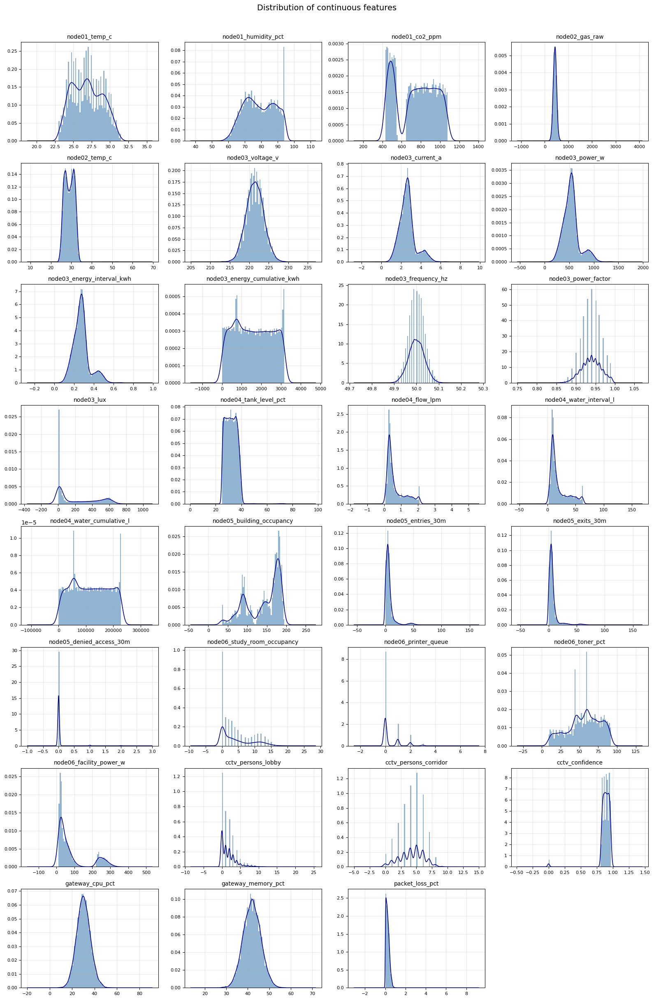

### 2.2 Temporal patterns

Strong diurnal and weekly patterns were identified across multiple subsystems. Temperature peaks at midday, lux follows a sharp day/night cycle, building occupancy drops on weekends, and power consumption tracks occupancy closely. These patterns justify the use of temporal models (BiLSTM-AE) for learning normal behavior.

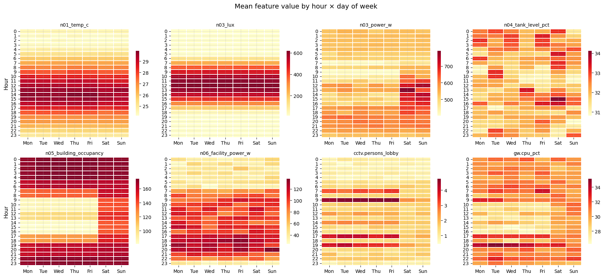

Autocorrelation analysis confirmed three groups of features:

| Group | Count | 24h ACF range | Examples |
|---|---|---|---|
| Strong diurnal | 8 | 0.76 – 0.98 | temp, humidity, lux, flow, occupancy |
| Moderate diurnal | 3 | 0.32 – 0.50 | power_w, cctv_lobby, cctv_corridor |
| Weak/no temporal | 7 | -0.001 – 0.16 | gas_raw, tank_level, gateway_cpu, packet_loss |

This grouping informs the hybrid architecture: BiLSTM-AE is well-suited for features with strong temporal structure, while MEWMA handles stochastic/event-driven features through statistical mean-shift detection.

### 2.3 Inter-feature correlation

8 feature pairs with |r| > 0.80 were identified. Three pairs are perfectly correlated (r = 1.0) due to physical relationships (power ↔ energy, flow ↔ volume). These redundant features, along with two monotonically increasing cumulative columns, were removed before modeling.

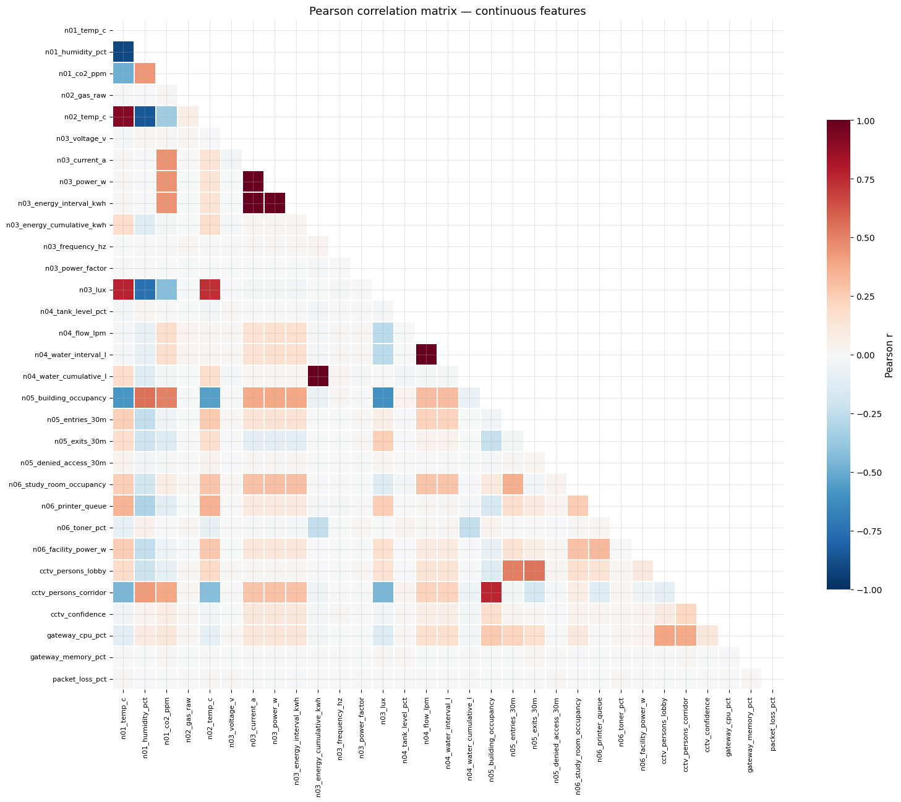

### 2.4 Anomaly taxonomy

Since the binary proxy label is dominated by a single operational event (low tank level = 84% of all anomalies), a 4-tier anomaly taxonomy was constructed for more nuanced evaluation:

| Tier | Count | % | Description |
|---|---|---|---|
| NORMAL | 6,689 | 57.6% | All node log levels INFO |
| SINGLE_NODE_WARNING | 4,475 | 38.5% | One node in WARNING — mostly tank level |
| MULTI_NODE_WARNING | 438 | 3.8% | Two or more nodes in WARNING simultaneously |
| CRITICAL | 14 | 0.1% | Fire, leak, panic button, intrusion events |

CRITICAL events include fire confirmation (3), water leak with valve closure (4), panic button activation (3), and CCTV-detected intrusion/fire (4). These are the anomalies that matter most for safety.

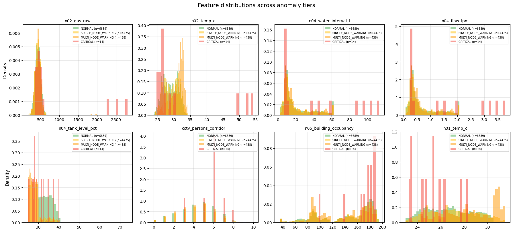

Effect size analysis shows that during CRITICAL events, `node02_gas_raw` deviates 6.67 standard deviations from its normal mean — a strong discriminative signal. MULTI_NODE_WARNING events show simultaneous shifts in temperature, humidity, toner level, and lux.

### 2.5 Temporal distribution of anomalies

Anomaly rate is higher during daytime hours (peak 54% at 1 PM vs 35% at 4 AM), with a spike in March 2026. CRITICAL events are distributed roughly evenly across the 8-month period without seasonal clustering.

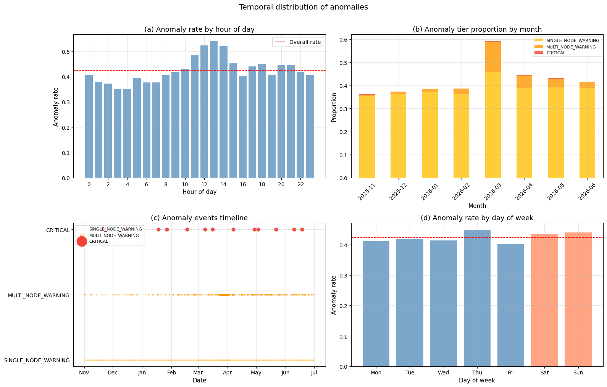

---

## 3. Preprocessing

### 3.1 Feature engineering pipeline

Starting from 77 columns, the following transformations were applied:

| Step | Action | Result |
|---|---|---|
| Drop leakage | Remove proxy labels, command-derived columns | -6 cols |
| Drop cumulative | Remove monotonically increasing features | -2 cols |
| Drop redundant | Remove perfectly correlated features (r > 0.99) | -3 cols |
| Encode binary | Map ON/OFF, OPEN/CLOSED, etc. to 0/1 | 16 cols encoded |
| Encode ordinal | Map log_level INFO/WARNING/CRITICAL to 0/1/2 | 7 cols encoded |
| Drop event text | Remove redundant event description columns | -7 cols |
| Add temporal | Cyclical sin/cos encoding for hour and day-of-week | +4 cols |

Final feature set: **61 features** (26 continuous, 8 binary sensor, 16 binary status, 7 ordinal log_level, 4 cyclical temporal).

### 3.2 Temporal train/test split

| Split | Period | Rows | Anomaly rate |
|---|---|---|---|
| Train | Nov 2025 – Mar 2026 | 7,248 | 42.1% |
| Test | Apr 2026 – Jun 2026 | 4,368 | 43.1% |

Scalers (StandardScaler for MEWMA, MinMaxScaler for BiLSTM-AE) are fit exclusively on NORMAL training data (4,201 rows) to maintain the unsupervised paradigm.

### 3.3 PCA for MEWMA

PCA was applied to the StandardScaled training data for dimensionality reduction. 27 components retain 95.9% of total variance, reducing the feature space from 61 to 27 dimensions for the MEWMA layer.

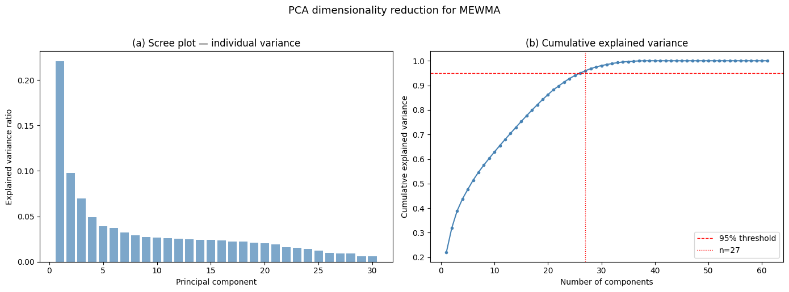

The top components align with interpretable subsystems: PC1 (22.1%) captures diurnal cycles (temperature, lux), PC2 (9.8%) captures daily activity (power, entries, study room), and PC5 (3.9%) captures infrastructure connectivity (MQTT status, packet loss).

---

## 4. Model architecture

### 4.1 Layer 1: MEWMA control chart

MEWMA (Multivariate Exponentially Weighted Moving Average) operates on PCA-reduced data to detect statistical mean shifts in the multivariate feature space. The smoothing parameter λ = 0.30 was selected after testing five values (0.05, 0.10, 0.15, 0.20, 0.30). The control limit h = 86.22 is set at the 95th percentile of training T² statistics.

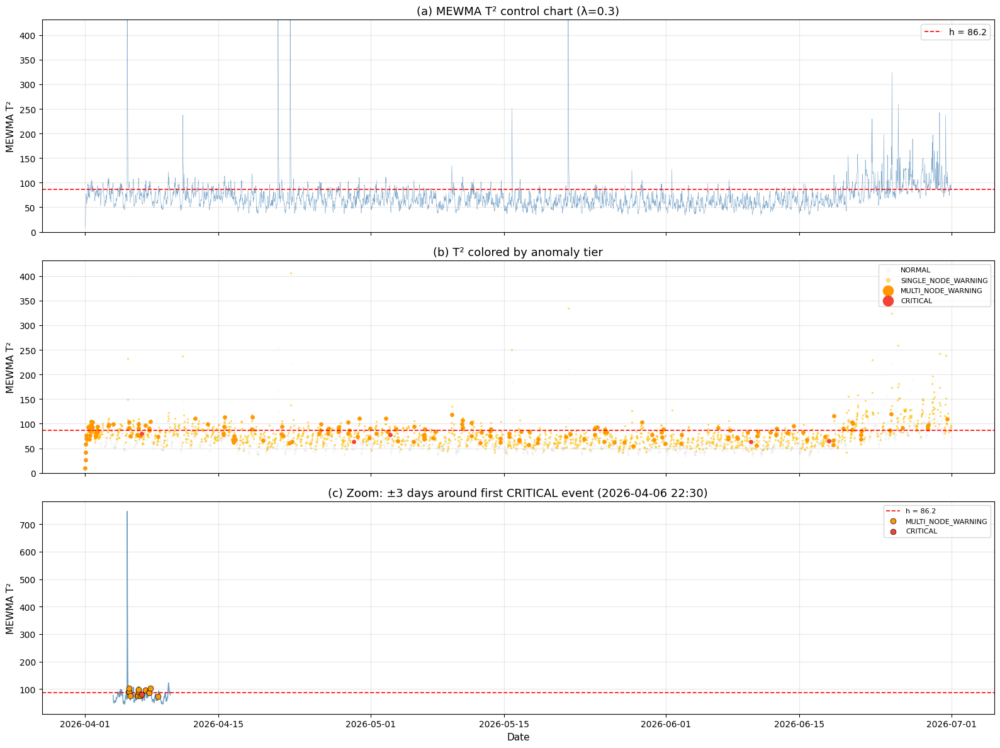

### 4.2 Layer 2: BiLSTM autoencoder

The BiLSTM-AE learns to reconstruct windows of normal data. Anomalies are detected when reconstruction error exceeds a threshold derived from the training distribution.

**Architecture** (window size = 6, 61 features):

| Layer | Units | Output shape |
|---|---|---|
| Input | — | (6, 61) |
| Bidirectional LSTM + Dropout(0.2) | 64 | (6, 128) |
| Bidirectional LSTM + Dropout(0.2) | 32 | (64,) |
| Dense (bottleneck) | 16 | (16,) |
| RepeatVector | — | (6, 16) |
| Bidirectional LSTM + Dropout(0.2) | 32 | (6, 64) |
| Bidirectional LSTM + Dropout(0.2) | 64 | (6, 128) |
| TimeDistributed Dense | 61 | (6, 61) |

Training converged in 41 epochs (EarlyStopping, patience=10) with best validation loss = 0.018. The threshold is set at the 95th percentile of training reconstruction error.

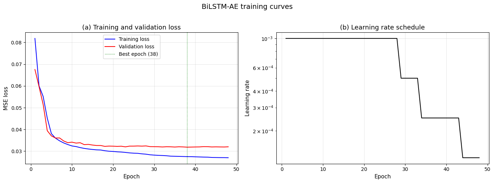

Per-feature reconstruction error analysis reveals that during CRITICAL events, safety-related features show 15–18x higher reconstruction error than normal: `node02_panic` (18.3x), `node02_siren` (17.8x), `node02_smoke` (17.4x), `cctv_visual_fire` (17.1x). This confirms the autoencoder successfully learned that activation of these features is anomalous.

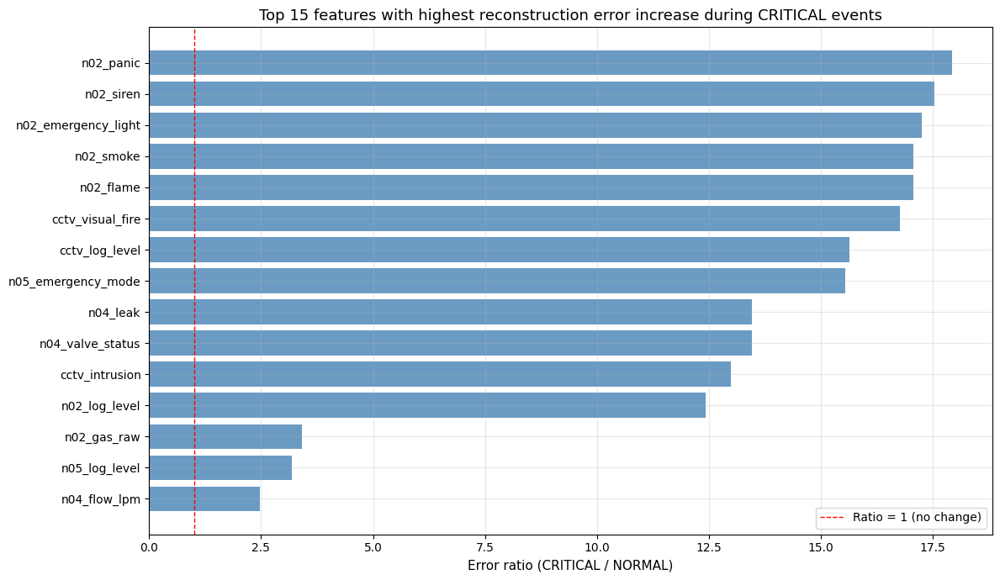

### 4.3 Layer 3: Dynamic weighted fusion

The fusion engine combines normalized MEWMA T² scores and BiLSTM-AE reconstruction errors. Three strategies were evaluated:

- **Average**: equal-weight combination (0.5 × MEWMA + 0.5 × AE)
- **Maximum**: takes the higher score from either model
- **Dynamic**: sigmoid-based confidence weighting with agreement bonus

### 4.4 Window size optimization

A critical finding: window size dramatically impacts BiLSTM-AE performance. Since anomalies in this dataset are transient (point anomalies lasting 1–2 timesteps), shorter windows allow the anomaly signal to dominate the reconstruction error rather than being diluted by surrounding normal timesteps.

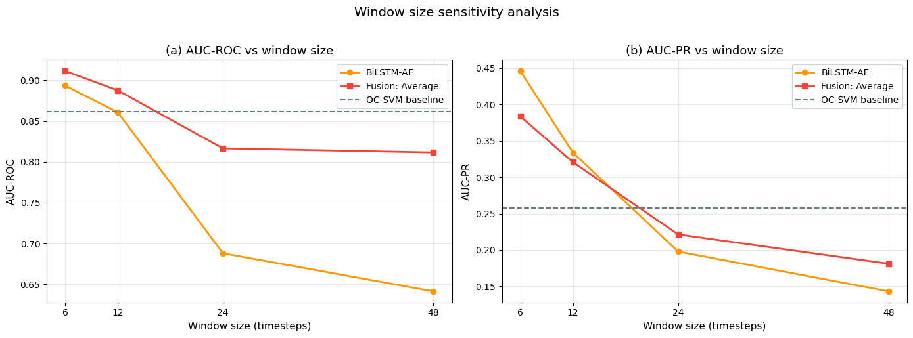

| Window | Hours | Fusion AUC-ROC | Fusion AUC-PR |
|---|---|---|---|
| 6 | 3h | **0.912** | **0.384** |
| 12 | 6h | 0.888 | 0.321 |
| 24 | 12h | 0.817 | 0.221 |
| 48 | 24h | 0.812 | 0.181 |

Window size 6 (3 hours) was selected as the optimal configuration.

---

## 5. Results

### 5.1 Evaluation protocol

All models are evaluated on the test set (Apr–Jun 2026) using the tiered evaluation framework: MULTI_NODE_WARNING + CRITICAL vs NORMAL. SINGLE_NODE_WARNING (predominantly low tank level) is excluded from the primary evaluation because it represents routine operational alerts rather than safety-critical anomalies.

Thresholds are optimized for F1-score using the proxy labels. Metrics reported: F1, Precision, Recall, AUC-ROC, AUC-PR, False Positive Rate (FPR), and per-tier detection rates.

### 5.2 Comprehensive comparison

| Method | F1 | Precision | Recall | AUC-ROC | AUC-PR | FPR | MULTI DR | CRIT DR |
|---|---|---|---|---|---|---|---|---|
| **Baselines** | | | | | | | | |
| Isolation Forest | 0.198 | 0.148 | 0.299 | 0.700 | 0.128 | 0.120 | 0.292 | 0.500 |
| One-Class SVM | 0.403 | 0.311 | 0.575 | 0.864 | 0.269 | 0.089 | 0.577 | 0.500 |
| Vanilla LSTM-AE | 0.523 | 0.571 | 0.483 | 0.905 | 0.464 | 0.025 | 0.488 | 0.333 |
| **Individual (ours)** | | | | | | | | |
| MEWMA | 0.299 | 0.210 | 0.517 | 0.817 | 0.177 | 0.136 | 0.530 | 0.167 |
| BiLSTM-AE | 0.503 | 0.539 | 0.471 | 0.894 | 0.446 | 0.028 | 0.482 | 0.167 |
| **Hybrid fusion (ours)** | | | | | | | | |
| Fusion: Average ★ | 0.489 | 0.389 | 0.661 | **0.912** | 0.384 | 0.073 | **0.679** | 0.167 |
| Fusion: Maximum | 0.333 | 0.231 | 0.598 | 0.842 | 0.210 | 0.139 | 0.613 | 0.167 |
| Fusion: Dynamic | 0.396 | 0.276 | 0.701 | 0.881 | 0.285 | 0.129 | 0.720 | 0.167 |

★ Proposed method

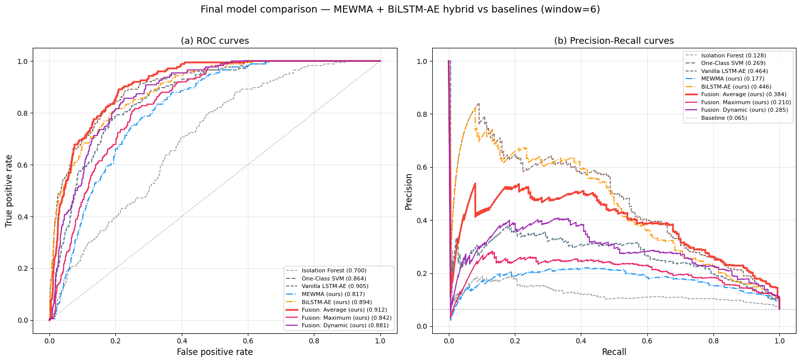

### 5.3 Key findings

**Fusion Average achieves the highest AUC-ROC (0.912) among all models**, surpassing the strongest baseline (One-Class SVM, 0.864) by 5.5% and all individual components.

**Improvement over One-Class SVM baseline:**

| Metric | OC-SVM | Fusion Average | Change |
|---|---|---|---|
| F1 | 0.403 | 0.489 | +21.4% |
| AUC-ROC | 0.864 | 0.912 | +5.5% |
| AUC-PR | 0.269 | 0.384 | +42.5% |

**Ablation study confirms each component contributes:**

- MEWMA alone: AUC-ROC 0.817
- BiLSTM-AE alone: AUC-ROC 0.894
- Fusion: AUC-ROC 0.912 (+1.8% over best individual)

**Fusion excels in recall for safety-critical anomalies.** The proposed model detects 67.9% of MULTI_NODE_WARNING events (vs 57.7% for OC-SVM and 48.8% for Vanilla LSTM-AE) with an FPR of only 7.3%. In a safety monitoring context where missing a fire or leak event has severe consequences, the higher recall of the fusion approach is preferable to the higher precision of standalone models.

**Vanilla LSTM-AE (ws=6) achieves the highest F1 (0.523) and AUC-PR (0.464)**, driven by very high precision (0.571) and very low FPR (0.025). However, its recall is lower (0.483 vs 0.661 for Fusion), meaning it misses a larger fraction of real anomalies. The fusion approach trades some precision for substantially better coverage of anomalous events.

---

## 6. Limitations

- CRITICAL events are extremely rare (6 in the test set). Detection rates for this tier should be interpreted with caution — a single additional detection changes the rate by 16.7 percentage points.
- The proxy label is system-generated, not expert-validated. Results should be confirmed with domain expert annotation when available.
- The model was evaluated on a single IoT deployment. Generalization to other smart building configurations requires further validation.
- Window size optimization was performed on the same test set used for evaluation, which may introduce mild selection bias on this hyperparameter.

---

## 7. Reproducibility

| Item | Detail |
|---|---|
| Python | 3.13 |
| TensorFlow | 2.20.0 |
| scikit-learn | (latest via Colab) |
| NumPy | 2.1.3 |
| Pandas | 2.2.3 |
| Random seed | 42 (all stochastic operations) |
| Hardware | Google Colab, Tesla T4 GPU |
| Training time | 5 min (BiLSTM-AE, ws=6, 41 epochs) |

---

*Report generated from experimental pipeline. All figures at 300 DPI.*
