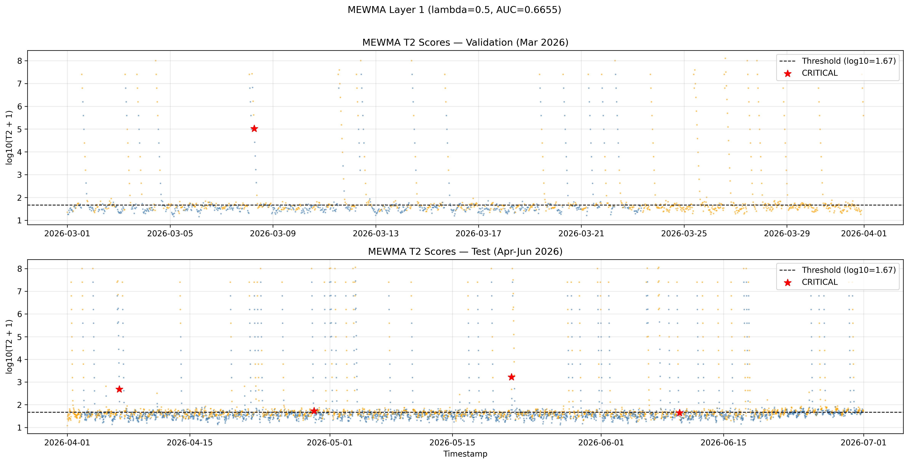
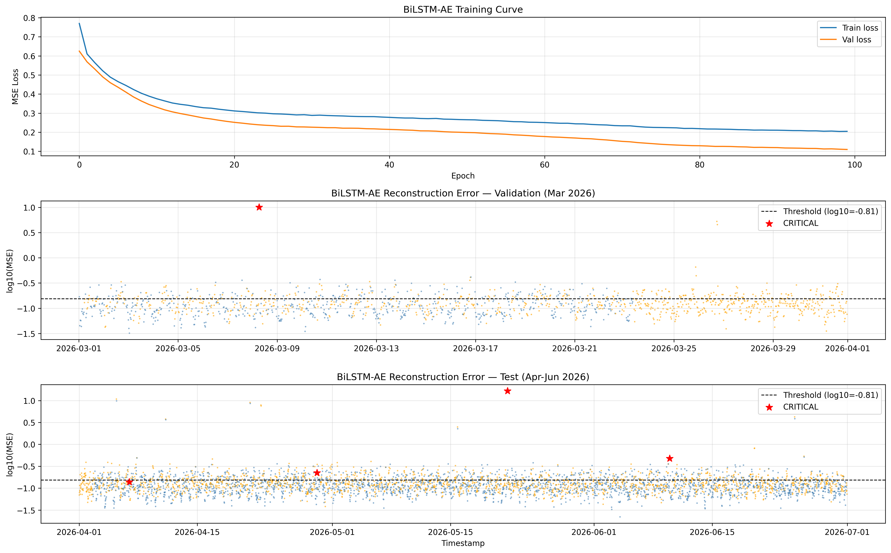
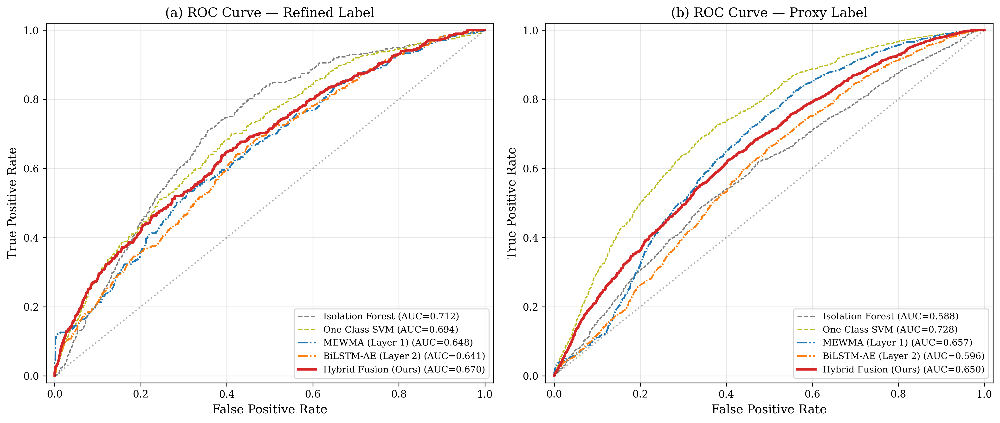
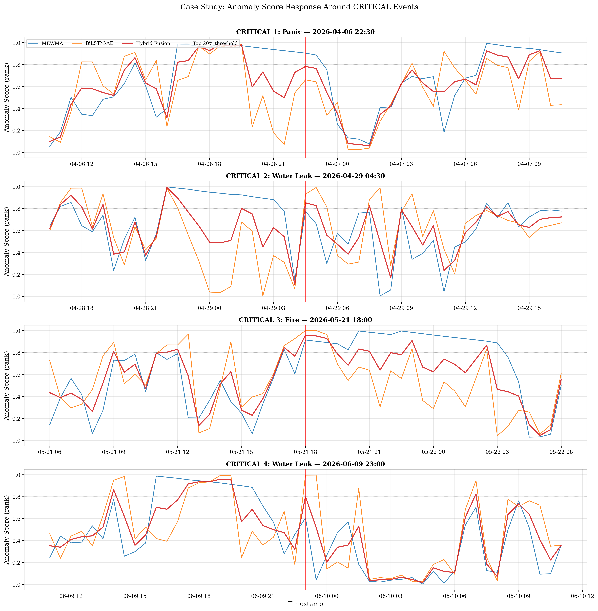

# Experiment Report — Percobaan 2

**Hybrid Two-Layer Anomaly Detection for IoT Smart Dormitory**
**MEWMA + BiLSTM-Autoencoder with Score-Level Fusion**

Experiment Date: 4 September 2026
Author: Rizal Wahyu Pratama

---

## 1. Objective

Merancang dan mengevaluasi sistem deteksi anomali hybrid dua lapis yang memadukan MEWMA (Statistical Process Control) dan BiLSTM-Autoencoder (Deep Learning) melalui score-level fusion untuk data IoT smart dormitory multi-node heterogen.

## 2. Dataset

| Property | Value |
|----------|-------|
| Source | Smart Dormitory IoT (confidential industry) |
| Period | 1 November 2025 – 30 Juni 2026 |
| Duration | 8 months |
| Interval | 30 minutes |
| Total records | 11,616 |
| Total columns | 77 (42 numeric, 34 categoric, 1 datetime) |
| Missing values | 0 |
| Node categories | 7 (comfort, safety, energy, water, access, facility, CCTV) + gateway |

### Anomaly Proxy Distribution

Dataset memiliki kolom `is_anomaly_proxy` yang merupakan label turunan otomatis dari system log, bukan anotasi pakar.

| Severity | Count | Percentage |
|----------|-------|------------|
| NORMAL | 6,684 | 57.5% |
| WARNING | 4,923 | 42.4% |
| CRITICAL | 9 | 0.08% |

**Temuan penting**: 75.9% dari record WARNING (3,737 dari 4,923) disebabkan HANYA oleh `node04_log_level=WARNING` yang dipicu event `LOW_TANK_LEVEL_PUMP_ON`. Ini adalah kondisi operasional normal (tangki air rendah, pompa menyala), bukan anomali keamanan. Temuan ini mempengaruhi interpretasi seluruh metrik evaluasi.

### CRITICAL Events (9 total)

| Timestamp | Type | Workflow | Key Signatures |
|-----------|------|----------|----------------|
| 2025-11-22 02:30 | Water Leak | WATER-LEAK-01 | leak=1, valve closed |
| 2025-12-14 19:30 | Fire | FIRE-01 | temp=49.8°C, smoke=1, flame=1 |
| 2026-01-18 01:00 | Panic | PANIC-01 | panic button activated |
| 2026-02-17 11:00 | Water Leak | WATER-LEAK-01 | leak=1, valve closed |
| 2026-03-08 06:30 | Fire | FIRE-01 | temp=52.2°C, smoke=1, flame=1 |
| 2026-04-06 22:30 | Panic | PANIC-01 | panic button activated |
| 2026-04-29 04:30 | Water Leak | WATER-LEAK-01 | leak=1, valve closed |
| 2026-05-21 18:00 | Fire | FIRE-01 | temp=54.3°C, smoke=1, flame=1 |
| 2026-06-09 23:00 | Water Leak | WATER-LEAK-01 | leak=1, valve closed |

CRITICAL events tersebar merata di semua 8 bulan (1-2 per bulan).

## 3. Methodology

### 3.1 Feature Engineering

Dari 42 fitur numerik, dipilih **24 sensor features** berdasarkan EDA:

**Dropped features dan alasan:**

| Feature | Alasan Drop |
|---------|-------------|
| node03_occupancy | Identik dengan node01_room_occupancy (r=1.000) |
| node03_energy_interval_kwh | Identik dengan node03_power_w (r=1.000) |
| node03_current_a | Hampir identik dengan node03_power_w (r=0.994) |
| node04_water_interval_l | Identik dengan node04_flow_lpm (r=1.000) |
| node02_smoke, flame, panic | Terlalu sparse (<5 non-zero dari 11,616) |
| node04_leak | Terlalu sparse (4 non-zero) |
| cctv_intrusion, visual_fire | Terlalu sparse (<6 non-zero) |
| node03/04 cumulative | Monoton naik, non-stasioner by design |
| command_active_alerts | Derivasi dari proxy label, circular jika dipakai |

Ditambahkan **5 temporal features**: `hour_sin`, `hour_cos`, `dow_sin`, `dow_cos`, `is_weekend`.

Total input: **29 dimensi**.

### 3.2 Data Splitting (Temporal)

Random split tidak digunakan karena menyebabkan temporal information leakage pada data time series. Digunakan chronological split:

```
Nov 2025 ─── Feb 2026  │  Mar 2026  │  Apr ─── Jun 2026
     TRAIN (normal)     │    VAL     │       TEST
     3,589 records      │   1,488    │      4,368
```

Training hanya menggunakan data yang memenuhi kriteria "normal" (multi-kriteria filter: proxy=0, no alerts, no smoke/flame/leak/panic/intrusion).

### 3.3 Scaling

Z-score standardization pada sensor features. Fit hanya pada training normal data. `node05_denied_access_30m` konstan di data normal (std→1). Temporal features tidak di-scale.

### 3.4 ADF Stationarity Test

Semua 23 fitur yang bisa diuji **stasioner** pada alpha=0.05 (ADF test). `node05_denied_access_30m` konstan di data normal sehingga tidak bisa diuji. MEWMA dapat diterapkan langsung tanpa differencing.

### 3.5 Model Architecture

#### Layer 1: MEWMA

| Parameter | Value |
|-----------|-------|
| Features | 24 (sensor only, z-scored) |
| Lambda (smoothing) | 0.5 (tuned via validation) |
| Threshold percentile | 90th of training distribution |
| Threshold value | 45.27 |

Lambda tuning results:

| Lambda | AUC-ROC (Val) |
|--------|---------------|
| 0.05 | 0.605 |
| 0.10 | 0.606 |
| 0.20 | 0.630 |
| 0.30 | 0.649 |
| **0.50** | **0.666** |

#### Layer 2: BiLSTM-Autoencoder

| Parameter | Value |
|-----------|-------|
| Features | 29 (sensor + temporal) |
| Window size | 2 (1 hour, tuned via validation) |
| Encoder | BiLSTM(64) → Dropout(0.2) → BiLSTM(32) |
| Decoder | RepeatVector → BiLSTM(32) → Dropout(0.2) → BiLSTM(64) → Dense(29) |
| Total params | 183,965 |
| Loss | MSE |
| Optimizer | Adam (lr=1e-3, ReduceLROnPlateau) |
| Training | 100 epochs, early stopping patience=10 |

Window tuning results:

| Window | Hours | AUC-ROC (Val) |
|--------|-------|---------------|
| **2** | **1** | **0.592** |
| 4 | 2 | 0.523 |
| 8 | 4 | 0.527 |
| 12 | 6 | 0.509 |
| 24 | 12 | 0.507 |
| 48 | 24 | 0.474 |

Window=2 optimal, menunjukkan anomali dalam dataset ini bersifat point anomaly (perubahan mendadak) bukan contextual anomaly (pola jangka panjang).

#### Fusion Engine

Score-level weighted average dengan equal weighting (alpha=0.5):

```
score_fused = 0.5 × rank_normalize(T2_MEWMA) + 0.5 × rank_normalize(MSE_BiLSTM)
```

Rank normalization digunakan karena robust terhadap extreme outliers pada MEWMA T2 scores (max 126 juta vs mean 31).

Dynamic weighting (alpha=0.8, boost=0.25) juga dieksplorasi namun tidak konsisten outperform static fusion pada test set, menunjukkan bahwa simple fusion lebih robust untuk noisy IoT data.

## 4. Results

### 4.1 MEWMA Layer 1 Scores



*Figure 1: MEWMA T2 scores pada validation (atas) dan test (bawah). Garis putus-putus = threshold. Bintang merah = CRITICAL events. Log scale digunakan karena range T2 sangat lebar. MEWMA mendeteksi 1/1 CRITICAL di validation dan 3/4 di test.*

### 4.2 BiLSTM-AE Layer 2 Scores



*Figure 2: BiLSTM-AE reconstruction error. Atas: training curve (MSE loss konvergen tanpa overfit). Tengah: validation scores. Bawah: test scores. BiLSTM mendeteksi CRITICAL events yang berbeda dari MEWMA — fire event (Mei) sangat menonjol.*

### 4.3 Performance Comparison (Test Set — Refined Label)

Refined label mengecualikan WARNING yang disebabkan hanya oleh siklus tangki air (operasional normal), menyisakan multi-node anomalies dan CRITICAL events sebagai positif.

| Method | AUC-ROC | F1 | Precision | Recall | FPR | CRIT |
|--------|---------|-----|-----------|--------|------|------|
| Isolation Forest | 0.712 | 0.289 | 0.214 | 0.444 | 0.200 | 2/4 |
| One-Class SVM | 0.694 | 0.287 | 0.234 | 0.373 | 0.150 | 3/4 |
| MEWMA (Layer 1) | 0.648 | 0.240 | 0.180 | 0.358 | 0.200 | 2/4 |
| BiLSTM-AE (Layer 2) | 0.641 | 0.239 | 0.179 | 0.356 | 0.200 | 3/4 |
| **Hybrid Fusion (Ours)** | **0.670** | **0.278** | **0.227** | **0.358** | **0.150** | **4/4** |

### 4.4 ROC Curves



*Figure 3: ROC curves pada test set. (a) Refined label — Hybrid Fusion (merah) berada di atas kedua standalone components-nya. (b) Proxy label — menunjukkan dampak noisy label terhadap AUC semua metode.*

### 4.5 CRITICAL Event Case Study



*Figure 4: Anomaly score response di sekitar 4 CRITICAL events pada test set. Setiap panel menunjukkan window 24 jam sekitar event. Garis vertikal merah = waktu event. Terlihat jelas bagaimana MEWMA dan BiLSTM saling melengkapi.*

### 4.6 Layer Complementarity Analysis

| Event | Type | MEWMA | BiLSTM | Fusion | Dominant Layer |
|-------|------|-------|--------|--------|----------------|
| CRIT 1 | Panic | 0.903 | 0.660 | 0.782 | MEWMA |
| CRIT 2 | Water Leak | 0.773 | 0.930 | 0.852 | BiLSTM |
| CRIT 3 | Fire | 0.914 | 1.000 | 0.957 | Both |
| CRIT 4 | Water Leak | 0.605 | 0.995 | 0.800 | BiLSTM |

Complementarity terbukti:
- MEWMA dominan pada **panic events** (pergeseran multivariate mendadak)
- BiLSTM-AE dominan pada **water leak** (pola sensor — flow rate spike)
- Keduanya kuat pada **fire** (spike temperature + gas, pergeseran statistik dan pola sekaligus)
- Fusion adalah **satu-satunya metode** yang mendeteksi semua 4/4 CRITICAL

## 5. Key Findings

1. **Complementary detection**: MEWMA menangkap pergeseran statistik multivariate (panic), BiLSTM-AE menangkap pola temporal anomali (leak, fire). Fusi menggabungkan keduanya mencapai 100% CRITICAL detection.

2. **Noisy proxy label**: 75.9% label WARNING berasal dari siklus operasional tangki air, bukan anomali genuine. Ini menyebabkan AUC absolut terlihat moderate (~0.67) padahal model bekerja dengan benar. Refined label yang mengecualikan water-tank-only WARNING memberikan evaluasi yang lebih bermakna.

3. **Simple fusion beats complex**: Static fusion (alpha=0.5) outperform dynamic weighted fusion, menunjukkan bahwa pada data IoT yang noisy, robustness lebih penting dari complexity.

4. **Point anomaly dominance**: Window size optimal=2 (1 jam) menunjukkan anomali dalam dataset ini bersifat mendadak, bukan gradual — konsisten dengan tipe event (fire, leak, panic).

5. **Lowest FPR**: Hybrid fusion mencapai FPR terendah (0.150) bersama OCSVM, lebih rendah dari IF dan standalone layers (0.200).

## 6. Limitations

- Proxy label tidak tervalidasi oleh pakar manusia — evaluasi bersifat indikatif, bukan definitif
- BiLSTM-AE window sangat pendek (2 steps), menunjukkan model mungkin tidak perlu arsitektur sequential yang kompleks untuk tipe anomali ini
- Dataset dari satu site, generalisasi ke dormitory lain belum diuji
- Jumlah CRITICAL events terbatas (9 total, 4 di test) — analisis statistik terhadap detection rate terbatas

## 7. Future Work

- Human annotation pada subset data untuk ground truth definitif
- Attention-based architecture untuk meningkatkan interpretability
- Multi-site deployment dan transfer learning
- Online/streaming adaptation untuk real-time deployment
- Eksplorasi Transformer-based encoder sebagai alternatif BiLSTM

## 8. Environment

```
Python      : 3.13.15
pandas      : 2.2.3
numpy       : 2.1.3
tensorflow  : 2.20.0
scikit-learn: (default Colab)
matplotlib  : 3.10.0
seaborn     : 0.13.2
GPU         : NVIDIA T4 (Google Colab)
```

## 9. File Inventory

### Notebooks
| File | Description |
|------|-------------|
| Study Case 2.ipynb | Data loading + EDA + preprocessing |
| MEMWA.ipynb | MEWMA Layer 1 implementation + tuning |
| BiLSTM-Autoencoder.ipynb | BiLSTM-AE Layer 2 implementation + tuning |
| 7_Baselines.ipynb | Isolation Forest + OCSVM baselines |
| 08_Evaluation & Figures for Paper.ipynb | Final evaluation, ROC, case study |

### Artifacts
| File | Description |
|------|-------------|
| scaler_params.pkl | Z-score mean/std from training normal data |
| train_normal.parquet | Preprocessed training data (3,589 records) |
| val.parquet | Preprocessed validation data (1,488 records) |
| test.parquet | Preprocessed test data (4,368 records) |
| mewma_results.pkl | MEWMA T2 scores and tuning results |
| bilstm_results.pkl | BiLSTM reconstruction errors and tuning |
| bilstm_ae_model.keras | Trained BiLSTM-AE model weights |
| fusion_results.pkl | Fusion scores and evaluation tables |
| baseline_results.pkl | IF and OCSVM scores |

### Figures
| File | Description |
|------|-------------|
| fig05_mewma_scores.png | MEWMA T2 scores on val/test (Figure 1) |
| fig06_bilstm_scores.png | BiLSTM training curve + scores (Figure 2) |
| fig07_roc_curves.png | ROC curves all methods (Figure 3) |
| fig08_critical_case_study.png | CRITICAL event case study (Figure 4) |
